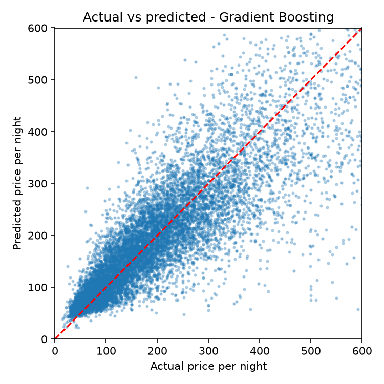

# 🏠 London Airbnb Price Estimator

An end-to-end machine learning project that predicts the nightly price of a London Airbnb listing from its features, with an interactive Streamlit app.

**Live demo:** https://london-airbnb-price.streamlit.app

## Problem
Hosts often struggle to price a listing: too high and it stays empty, too low and they lose income. This project builds a model that estimates a sensible nightly price from the listing's location, size, room type, bathrooms and amenities.

## Data
[Inside Airbnb](https://insideairbnb.com/get-the-data/) London `listings.csv.gz` (public listing data, licensed CC BY 4.0). Data source: Inside Airbnb.

## Approach
1. **Cleaning:** converted price text (e.g. "$1,250.00") to numbers, removed extreme outliers (below 10 or above 1,000 per night), counted amenities from the amenities list, and extracted the number of bathrooms from the `bathrooms_text` column because the `bathrooms` column is empty in newer files.
2. **Target transform:** modelled `log(price)` because prices are heavily right-skewed.
3. **Preprocessing:** median imputation and scaling for numeric features, most-frequent imputation and one-hot encoding for categorical features, all inside a scikit-learn `Pipeline` so the same steps run in training and in the app.
4. **Model comparison:** Ridge Regression, Random Forest and Gradient Boosting, compared with 5-fold cross-validation (R² on log price) on the training set only.
5. **Evaluation:** the best model was evaluated once on a held-out 20% test set and reported in real price units.
6. **Explainability:** permutation importance shows which features drive predictions.
7. **Deployment:** Streamlit app deployed on Streamlit Community Cloud.

## Results

| Model | CV R² (log price) |
|---|---|
| Ridge Regression | 0.680 |
| Random Forest | 0.760 |
| **Gradient Boosting (best)** | **0.769** |

**Test set (held out):** R² = 0.651 | MAE = 54.5 per night | RMSE = 95.1 | median listing price = 172




## Key findings
- Nightly prices are strongly right-skewed, so modelling the log of price helped. Gradient Boosting beat the linear baseline by a wide margin (CV R² 0.77 vs 0.68), which shows that price depends on non-linear combinations of features such as location and room type.
- The typical prediction error is about 54.5 per night, roughly a third of the median price. That is useful as a guide, but not precise enough to set a price automatically.
- The model tends to underestimate very expensive listings and slightly overestimate cheap ones, which is common for tree-based models predicting near the average.

## Run it locally
```bash
git clone https://github.com/Maaz322131/AirBnb-london-price.git
cd AirBnb-london-price
python -m venv .venv
.venv\Scripts\activate          # Mac/Linux: source .venv/bin/activate
pip install -r requirements.txt

# put listings.csv.gz (Inside Airbnb, London) into the data/ folder, then:
python src/train.py
streamlit run app.py
```

## Project structure
```
AirBnb-london-price/
├── app.py            # Streamlit app
├── src/train.py      # cleaning, training, evaluation, plots
├── data/             # dataset (not committed)
├── models/           # saved model
├── reports/          # metrics and figures
└── requirements.txt
```

## Limitations and next steps
- Prices are listing prices, not what guests actually paid, and the data is a snapshot in time.
- Listings above 1,000 per night were removed, so luxury listings are out of scope.
- Guest review text is not used yet.
- Next: hyperparameter tuning, review sentiment as a feature, per-listing explanations with SHAP, and a borough-level price map.
