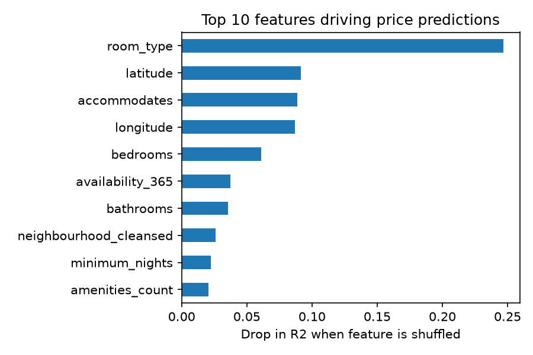

# 🏠 London Airbnb Price Estimator

An end-to-end machine learning project that predicts the nightly price of a London Airbnb listing from its features, with an interactive Streamlit app.

**Live demo:** _add your Streamlit Community Cloud link here_

## Problem
Hosts often struggle to price a listing: too high and it stays empty, too low and they lose income. This project builds a model that estimates a sensible nightly price from the listing's location, size, room type and amenities.

## Data
[Inside Airbnb](https://insideairbnb.com/get-the-data/) London `listings.csv.gz` (scraped public listing data, licensed CC BY 4.0). Data source: Inside Airbnb.

## Approach
1. **Cleaning:** converted price text (e.g. "$1,250.00") to numbers, removed extreme outliers (below 10 or above 1,000 per night), and counted amenities from the amenities list.
2. **Target transform:** modelled `log(price)` because prices are heavily right-skewed.
3. **Preprocessing:** median imputation and scaling for numeric features, most-frequent imputation and one-hot encoding for categorical features, all inside a scikit-learn `Pipeline`.
4. **Model comparison:** Ridge Regression, Random Forest and Gradient Boosting, compared with 5-fold cross-validation (R²) on the training set only.
5. **Evaluation:** best model evaluated once on a held-out 20% test set, reported in real price units (MAE, RMSE, R²).
6. **Explainability:** permutation importance shows which features drive predictions.
7. **Deployment:** Streamlit app returning an estimated nightly price.

## Results
_Fill in after running `python src/train.py` (see `reports/metrics.json`):_

| Model | CV R² (log price) |
|---|---|
| Ridge Regression | |
| Random Forest | |
| Gradient Boosting | |

**Test MAE:** _x per night_ | **Test R²:** _x.xx_



## Key findings
_Write 2-3 bullets from your own results: which features matter most (e.g. room type, accommodates, location), and how accurate the model is relative to the median price._

## Run it locally
```bash
git clone <your-repo-url>
cd airbnb-london-price
python -m venv .venv && source .venv/bin/activate   # Windows: .venv\Scripts\activate
pip install -r requirements.txt

# put listings.csv.gz (Inside Airbnb, London) into the data/ folder, then:
python src/train.py
streamlit run app.py
```

## Project structure
```
airbnb-london-price/
├── app.py            # Streamlit app
├── src/train.py      # cleaning, training, evaluation, plots
├── data/             # dataset (not committed)
├── models/           # saved model
├── reports/          # metrics and figures
└── requirements.txt
```

## Limitations and next steps
- Prices are listing prices, not what guests actually paid.
- Extreme outliers were removed, so very luxury listings are out of scope.
- Next: NLP on guest reviews (sentiment as a feature), hyperparameter tuning, and per-listing explanations with SHAP.
